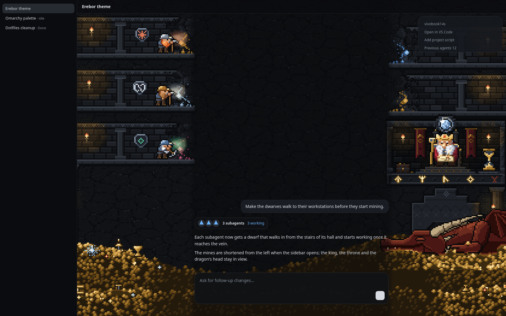
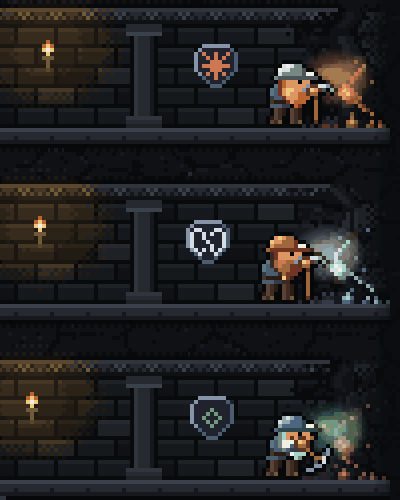
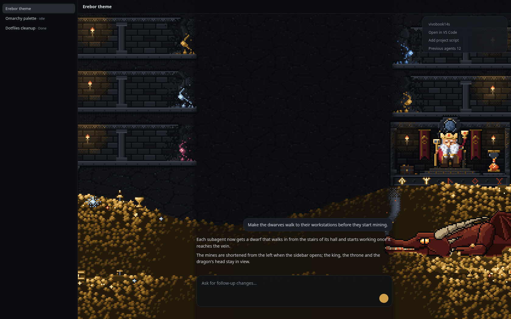

# Erebor

A dark theme for [T3 Code](https://github.com/pingdotgg/t3code) that draws a living dwarven mountain behind the chat. The scene follows your session: the dragon's hoard grows with the context window, dwarves mine while subagents run, and the King under the Mountain shows what the thread is doing.



## What the scene shows



- **Dwarves** mine one tunnel each while subagents run, up to five. They walk in when a subagent starts and walk out when it finishes. The lamp colour and the rune shield show the provider: terracotta for Claude, silver for Codex, green for others.
- **The king** reads the scroll while the thread works, raises a hand when it waits for you, toasts when it is done, dozes after two minutes and slumps when it fails.
- **The hourglass and the Arkenstone** drain with the 5-hour limit. **Five runes** on the throne floor show the weekly limit in 10 % steps.
- **The hoard** rises with the context window. The dragon wakes at 80 % and rages at 90 %.

<br clear="right">



## Install

You need T3 Code. The built theme is in `dist/`, so you do not need to build anything.

1. Clone the repository:

   ```sh
   git clone https://github.com/RedHot099/erebor-t3-theme.git
   cd erebor-t3-theme
   ```

2. Copy the theme into T3 Code's theme folder, `~/.t3/userdata/themes` (or `$T3CODE_HOME/userdata/themes`).
   - On Linux or macOS:

     ```sh
     ./install.sh
     ```

   - On Windows, in PowerShell:

     ```powershell
     $themes = if ($env:T3CODE_HOME) { "$env:T3CODE_HOME\userdata\themes" } else { "$HOME\.t3\userdata\themes" }
     New-Item -ItemType Directory -Force $themes | Out-Null
     Copy-Item dist\erebor.json, dist\erebor.png $themes
     ```

3. In T3 Code, open **Settings** and select **Erebor** under **Theme**. If it is not in the list, restart T3 Code.

To update, run `git pull` and repeat step 2.

## Good to know

- Keep the **thread details** card open. The context and limit numbers exist only there, so with the card closed the scene keeps the last values. The theme hides the card's **Usage limits** and **Context window** sections to keep it small.
- The scene reads the app's English labels, so use T3 Code in English.
- Use the default or **wide** chat width. The **full** width is not supported.

## Development

[Developing the Erebor theme](docs/development.md) covers the build, the offline preview, the checks and the art generators. [How the Erebor theme works](docs/how-it-works.md) explains how a CSS-only theme draws the scene and reads the app's state.
